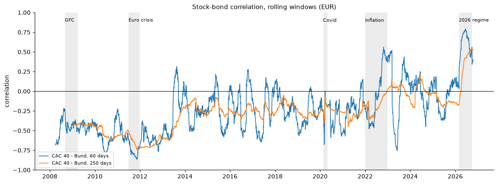
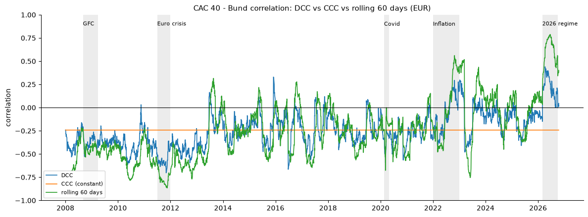
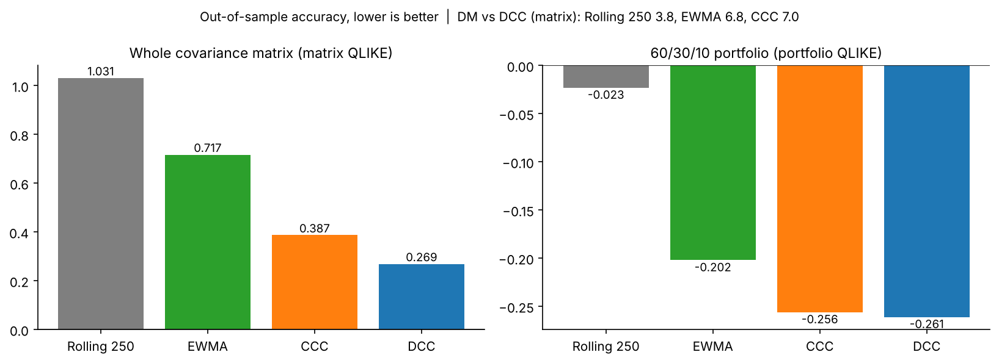
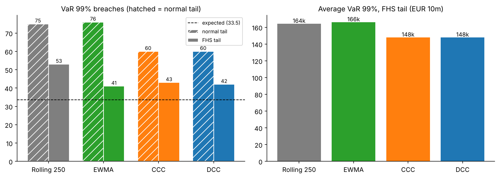
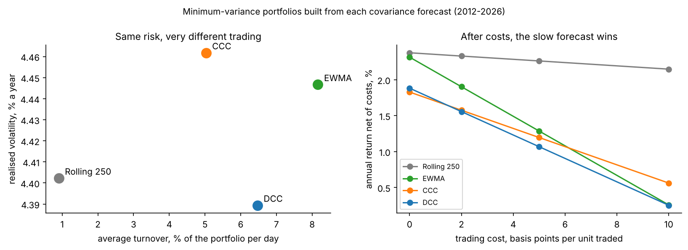

# Multivariate Volatility: Rolling, EWMA, CCC and DCC

**How should a buy-side risk team forecast the covariance matrix of a multi-asset portfolio, and does a dynamic-correlation model give better risk numbers and better portfolios than constant or rolling correlations?**

This project forecasts the daily covariance matrix of a **EUR multi-asset portfolio** — CAC 40, DAX, S&P 500, German Bunds and gold — with four models: a rolling window, EWMA (RiskMetrics), CCC-GARCH and DCC-GARCH. Everything, including the DCC maximum likelihood, is implemented from scratch in Python and checked against scipy, pandas, the `arch` package and simulations with known parameters. The models are compared out of sample over **3,602 days (January 2012 – October 2026)** on three questions a buy-side team cares about: forecast accuracy, portfolio VaR/ES backtests, and the minimum-variance portfolios each model would build.

Methods follow J. Daníelsson, *Financial Risk Forecasting* (Wiley, 2011), Chapter 3, applied to current data.

---

## Executive summary

| | Result |
|---|---|
| **Correlations are not constant** | The stock–Bund correlation moved from **−0.87** (2011) to **+0.79** (2026). DCC beats constant correlation in-sample with LR = 889. |
| **Best covariance forecast** | **DCC**: matrix QLIKE 0.269 vs CCC 0.387, EWMA 0.717, rolling 1.031; significant against every model (Diebold–Mariano 3.8–7.0). |
| **Portfolio VaR / ES** | With filtered-historical-simulation tails, DCC and CCC pass every backtest with **11% less VaR than EWMA**; normal tails fail for every model; the rolling window fails even with FHS. |
| **Portfolio construction** | DCC builds the least volatile minimum-variance portfolio, but trades **7× more** than the rolling window; **after 5 bp of trading costs, the slow rolling window is best.** |
| **Key lesson** | Different jobs need different models: DCC to *measure* risk, a smooth forecast to *build* portfolios. Never assume a fixed stock–bond hedge. |
| **Data quality** | Yahoo's adjusted Bund prices missed 8 coupon payouts before 2013 (fake −2% to −3.5% "crashes"); the total return was rebuilt from close prices and payouts. |

---

## Data and design

- **Assets (all in EUR):** CAC 40 (`^FCHI`), DAX (`^GDAXI`), S&P 500 (`^GSPC`), German Bunds 5.5–10.5y (`EXHD.DE`, total return rebuilt), gold (`GLD`). EUR/USD from FRED (`DEXUSEU`).
- **Calendar:** only days where all prices exist — **4,602 days, January 2008 – October 2026**.
- **Portfolio:** 60/30/10 (20% per equity index, 30% Bunds, 10% gold), rebalanced daily.
- **Models:** rolling 250-day covariance; EWMA (λ = 0.94); CCC and DCC with GJR-GARCH(1,1) Student-t volatilities per asset and a two-step Gaussian quasi-likelihood for the correlations.
- **Out of sample:** 1,000-day estimation window, re-estimated every 20 days (181 estimations, all converged); every forecast for day *t* uses data up to *t − 1*, verified with a fake-crash look-ahead test.
- **Evaluation:** matrix and portfolio QLIKE with Diebold–Mariano tests; portfolio VaR 99% / ES 97.5% (normal and FHS tails) with Kupiec, Christoffersen and Acerbi–Szekely backtests; minimum-variance portfolios with realised volatility, turnover and trading costs.

---

## Results

### 1. The stock–bond correlation changes sign



Bunds hedged equities strongly in the euro crisis (−0.87 on 60 days) and not at all in 2022; from March 2026 they moved *with* equities (+0.62 for the year, confirmed by a second Bund ETF and month by month). A 250-day window turned positive a full month after the regime change.

### 2. DCC follows the changes; CCC cannot



DCC (a = 0.031, b = 0.945, half-life 28 days) tracks the 60-day correlation with half of EWMA's noise and no ghost effects, but is "muted" in lasting regimes: it pulls correlations back towards their long-run average (+0.44 at the 2026 peak vs +0.79 on 60 days).

### 3. Out-of-sample accuracy



| | Rolling 250 | EWMA | CCC | DCC |
|---|---|---|---|---|
| Matrix QLIKE (lower = better) | 1.031 | 0.717 | 0.387 | **0.269** |
| DM vs DCC | 3.8 | 6.8 | 7.0 | – |
| Portfolio QLIKE (60/30/10) | −0.023 | −0.202 | −0.256 | **−0.261** |

For the single 60/30/10 portfolio, DCC and CCC are statistically tied (DM 1.85): the per-asset GJR volatilities do most of the work. In 2026, EWMA's fast forgetting matches DCC and constant correlation is worst.

### 4. Portfolio VaR and ES



| FHS tails, 3,352 days | Breaches 99% (33.5 exp.) | Consecutive | Christoffersen *p* | Avg VaR 99% (EUR 10m) |
|---|---|---|---|---|
| Rolling 250 | 53 | 11 | 0.000 ✗ | 164k |
| EWMA | 41 | 2 | 0.12 | 166k |
| CCC | 43 | 1 | 0.25 | **148k** |
| DCC | 42 | 1 | 0.31 | **148k** |

### 5. Minimum-variance portfolios: the cost of trading on a forecast



All four minimum-variance strategies run at about 4.4% volatility (vs 9.7% for 60/30/10). DCC's is the least volatile, significantly better than CCC's (DM 3.38) but not than rolling's — and it turns over 6.5% of the portfolio a day against 0.9%. At 5 bp per unit traded, DCC loses 0.82% a year to costs, the rolling window 0.11%.

---

## Recommendations

1. **Risk measurement:** DCC-GJR covariance with filtered-historical-simulation tails; re-estimate monthly; monitor the stock–bond correlation as a key risk indicator.
2. **Portfolio construction:** do not trade on raw daily DCC forecasts; use a smoothed covariance (rolling window, shrinkage, trading bands or a turnover penalty).
3. **Stress testing:** always test portfolios under a positive stock–bond correlation (2022, 2026 scenarios).

## Validation

- Every function checked before use: closed forms, scipy (multivariate normal and Student-t densities), pandas (`ewm`), the `arch` package (GJR parameters to 3–4 decimals), hand-worked examples, and simulations with known parameters (DCC a = 0.05, b = 0.93 recovered as 0.052, 0.928).
- No look-ahead verified directly with a fake crash inserted in the data.
- **26 unit tests:** `pytest -v`.

## Limitations

- One (a, b) for all 10 correlation pairs; symmetric DCC; Gaussian quasi-likelihood for correlations.
- Non-synchronous closes (European indices, New York, Xetra ETF, FX fixing).
- Bund history from 2008 only on Yahoo; 8 payouts before 2013 estimated from the ex-date price drop.
- Minimum-variance portfolios with short sales, no constraints, linear costs.

---

## Repository structure

```
multivariate-volatility-dcc/
├── README.md
├── notes/theory.md                    # theory notes: Equations 1-18 with examples
├── notebooks/01_multivariate.ipynb    # the full analysis, Sections 1-11, with findings
├── src/covforecast/
│   ├── data.py                        # Bund total return, EUR returns on a common calendar, portfolio
│   ├── covariance.py                  # portfolio variance, rolling and EWMA covariance, correlations
│   ├── univariate.py                  # GJR-GARCH(1,1) Student-t
│   ├── mgarch.py                      # CCC, DCC (recursion, likelihood, estimation), rolling forecasts
│   ├── evaluation.py                  # matrix / portfolio QLIKE, Diebold-Mariano
│   ├── risk.py                        # portfolio VaR / ES (normal, FHS), Kupiec, Christoffersen, Acerbi-Szekely
│   ├── portfolio.py                   # minimum-variance weights, turnover
│   └── plots.py                       # every chart of the project
├── tests/test_covforecast.py          # 26 unit tests
├── reports/
│   ├── Project4_Report.docx           # full report with interview questions
│   └── figures/
├── pytest.ini
└── requirements.txt
```

## How to run

```
conda activate quant
pip install -r requirements.txt
pytest -v
jupyter lab
```

Open `notebooks/01_multivariate.ipynb` and run all cells. The data are downloaded from Yahoo Finance and FRED on the first run and saved in `data/raw/`; the out-of-sample estimation (about 6 minutes) is saved in `data/processed/` and reloaded afterwards.
